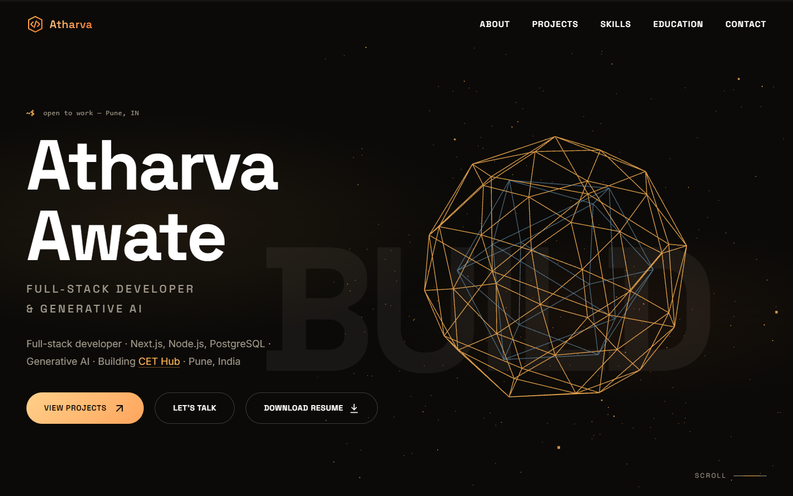
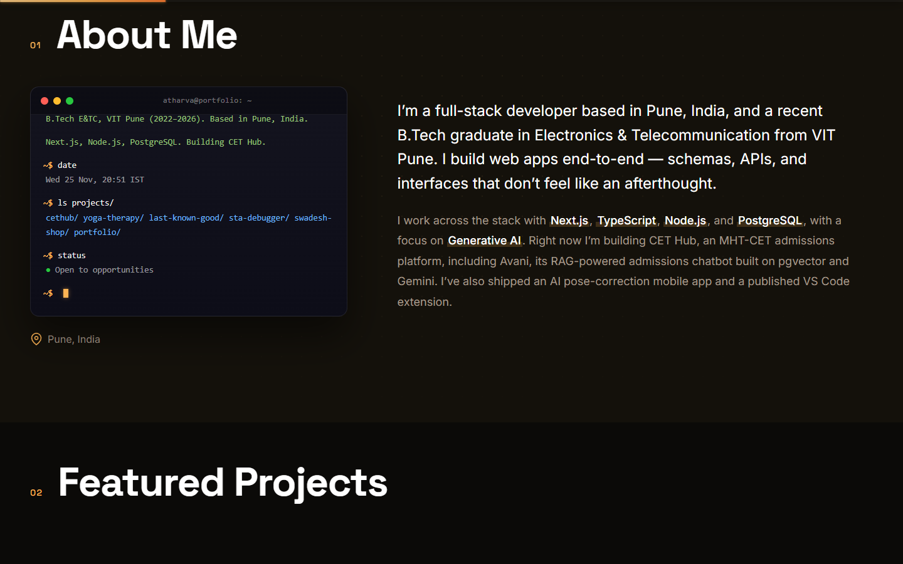
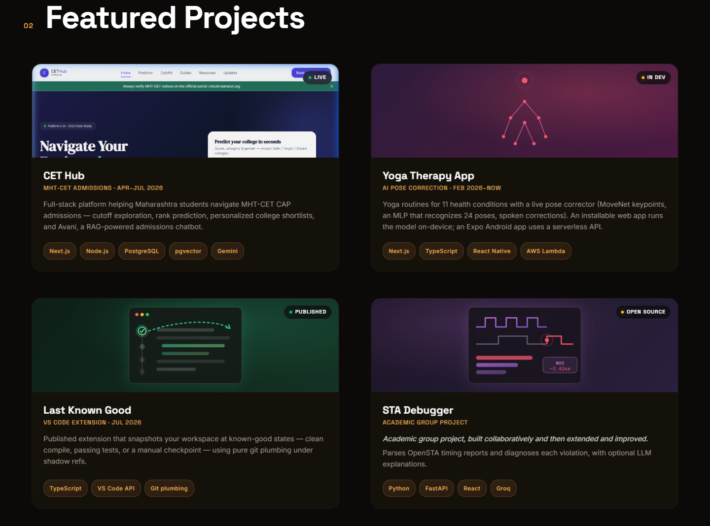
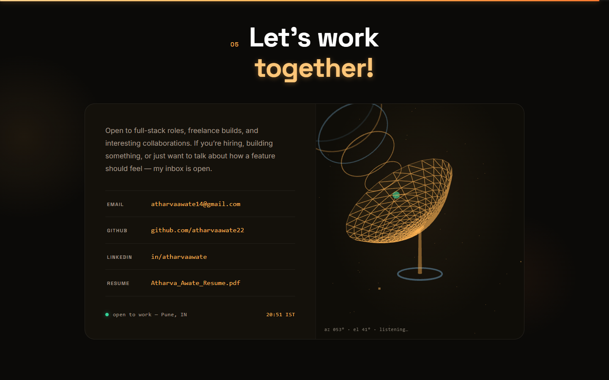

# atharvaawate.me

Personal portfolio. Vanilla HTML/CSS/JS with custom Three.js scenes and
GSAP scroll animations — no framework, no build step.

**Live:** [atharvaawate.me](https://atharvaawate.me)

## Screenshots

Captured from the live site in November 2026.

<table>
  <tr>
    <td width="50%"><a href="docs/screenshots/hero.png"></a><br /><sub><b>Hero</b>: Three.js wireframe icosahedron, cycling backdrop word, resume download</sub></td>
    <td width="50%"><a href="docs/screenshots/about.png"></a><br /><sub><b>About</b>: terminal that types <code>whoami</code>, a live IST <code>date</code>, <code>ls projects/</code> and <code>status</code></sub></td>
  </tr>
  <tr>
    <td width="50%"><a href="docs/screenshots/projects.png"></a><br /><sub><b>Projects</b>: cards with status badges, a real screenshot or SVG mockup, and a detail modal</sub></td>
    <td width="50%"><a href="docs/screenshots/contact.png"></a><br /><sub><b>Contact</b>: Three.js satellite dish that scans the sky, with a live IST clock</sub></td>
  </tr>
</table>

## Features

- Real-time 3D: wireframe icosahedron in the hero, satellite dish in the
  contact section (Three.js, colors driven by CSS variables)
- Animated terminal in the About section — types `whoami`, `cat about.md`,
  a live `date` in IST, `ls projects/`, and `status`; pauses on hover
- Hero text scramble; backdrop word cycles through `CRAFT / BUILD / SHIP`
- Project cards with per-project SVG mockups and real screenshots, each
  opening a detail modal (keyboard-operable)
- Skills grouped into Frontend, Backend, Databases, Generative AI,
  Mobile & ML, and DevOps & Tooling
- Education & credentials section styled as `~/education`,
  `~/certifications`, `~/publications` blocks
- Resume download (`assets/Atharva_Awate_Resume.pdf`)
- Magnetic cursor and CTAs on fine-pointer devices
- Respects `prefers-reduced-motion` (static terminal snapshot, no scramble)

## Structure

```
index.html          single page
css/                base (variables/reset), components, sections,
                    animations, premium (terminal, badges, mockups)
js/                 cursor, effects (terminal/scramble), animations (GSAP),
                    three-scenes, interactions (modal), main (nav)
assets/             favicons, project screenshots, resume PDF
about/              redirect from the old /about page to /
archive/            alternate contact-section scenes (airplane, globe, dish), not loaded
docs/screenshots/   README screenshots
scripts/            one-off screenshot helpers (CET Hub preview, OG image)
```

## Run locally

```bash
npx http-server -p 8080
```

Static site — any file server works.

## Deployment

Every push to `main` deploys to GitHub Pages through
`.github/workflows/deploy-pages.yml`; `CNAME` points the site at
atharvaawate.me.

## Theme

The palette lives in `css/base.css` as custom properties (`--color-accent`,
`--color-gradient-1/2`, `--color-cool`, …). The Three.js scenes read the
same variables, so changing the palette is a one-file edit.

## Author

**Atharva Awate** — [GitHub](https://github.com/atharvaawate22) ·
[LinkedIn](https://www.linkedin.com/in/atharvaawate) ·
[atharvaawate14@gmail.com](mailto:atharvaawate14@gmail.com)
